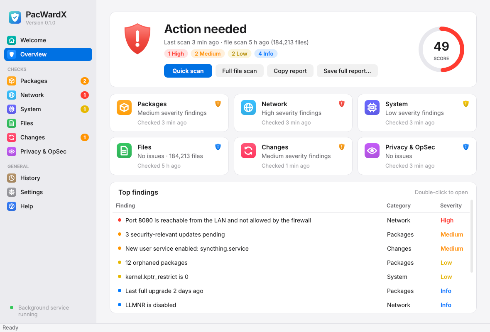
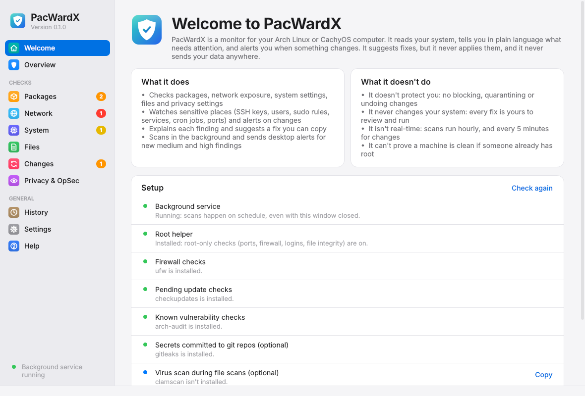
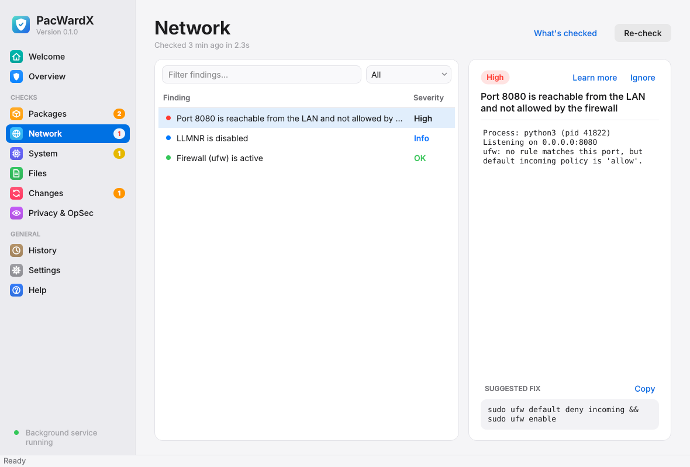
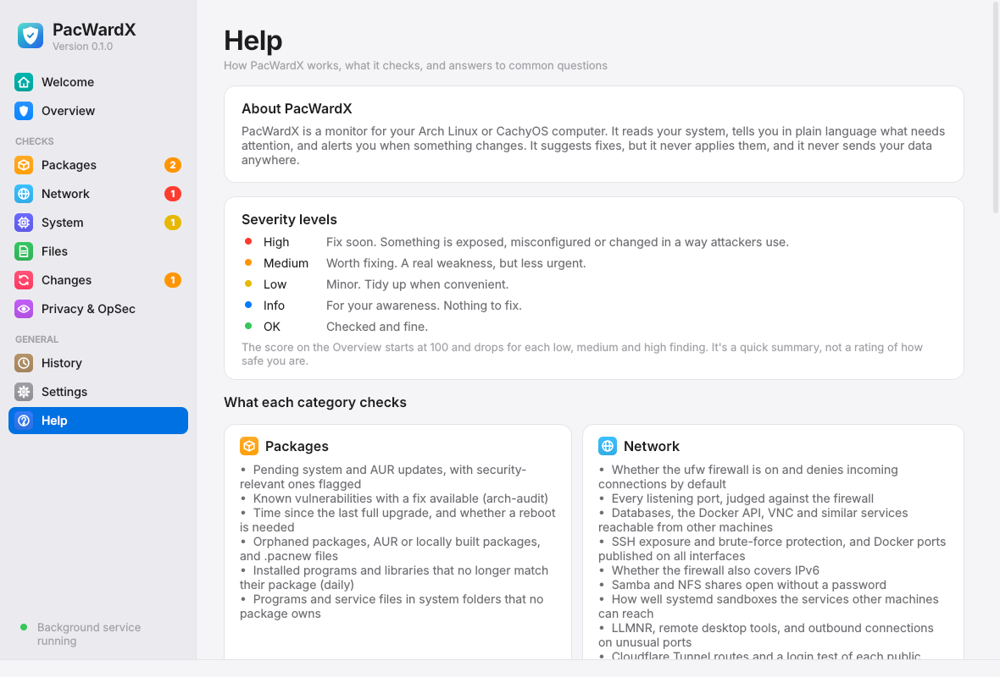
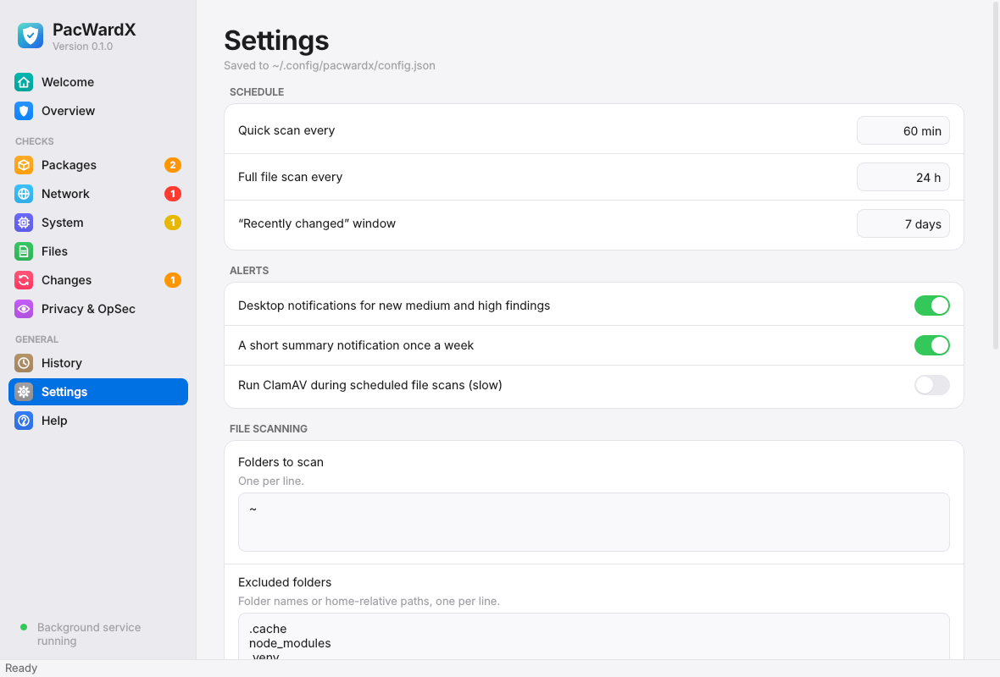
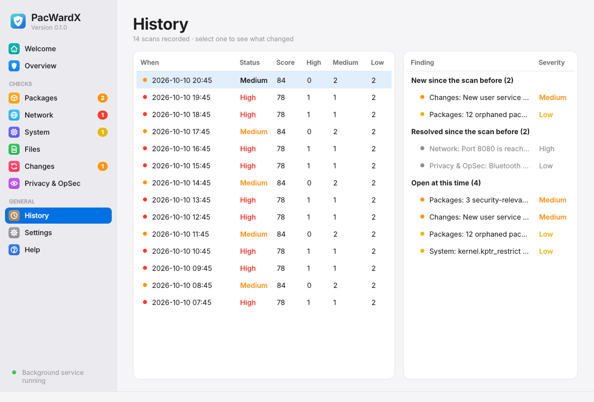

<div align="center">


# PacWardX

**A calm, always-on security monitor for Arch Linux and CachyOS.**

It checks packages, network exposure, hardening, files, persistence and privacy in the background,<br>
then tells you in plain language what needs attention and how to fix it.


[](https://github.com/devbnkdr/PacWardX/actions/workflows/ci.yml)

<br>

<picture>
  <source media="(prefers-color-scheme: dark)" srcset="docs/overview-dark.png">
  
</picture>

</div>

<br>

## About

I built PacWardX to keep an eye on my own Arch Linux machine, a workstation I use for development,
self-hosting and everyday use. It grew into a full monitor, so I'm sharing it in case it helps someone else.
It's a personal project, not a commercial product.

## What PacWardX is, and what it isn't

PacWardX is a **monitor and viewer**. It looks at your system, tells you what it found, and alerts you when
something changes. It suggests fixes, but it never applies them. You decide what to do.

**What it does**

- Reads your system's settings, installed packages, open network ports, firewall rules, startup items,
  user accounts and selected files, and reports anything risky in plain language.
- Takes a snapshot of sensitive places (SSH keys, users, sudo rules, services, cron jobs, open ports and
  more) and alerts you when anything in them is added or changed.
- Shows a severity, an explanation and, where it can, a suggested command for each finding.
- Sends desktop notifications for new medium and high findings, and keeps a history of past scans.
- Lets you copy or save a report of the results.

**What it doesn't do**

- **It doesn't protect you.** It isn't an antivirus, firewall or intrusion-prevention system. It doesn't
  block connections, stop programs, quarantine files or undo changes.
- **It doesn't change your system.** Every check only reads. Suggested fixes are text for you to review and
  run yourself, if you choose to.
- **It doesn't watch in real time.** It scans on a schedule (every hour, and every 5 minutes for changes),
  so something can happen between scans.
- **It can't prove a machine is clean.** Someone who already has root access can hide from it.
- **It doesn't send your data anywhere.** See [Your data and privacy](#your-data-and-privacy).

## How it works

- **One glance, one answer.** A shield and a score on the dashboard tell you whether anything needs you. The tray icon changes colour with the worst open finding.
- **Runs quietly in the background.** A `systemd --user` service scans on a schedule, and the window closes to the tray.
- **Root only where needed.** A few checks need root to read. A small helper with a fixed set of read-only commands does that, so the app itself never runs as root.
- **Follows your desktop.** Light and dark appearance switch live with your system theme.

<table>
  <tr>
    <td width="50%"></td>
    <td width="50%"></td>
  </tr>
  <tr>
    <td align="center"><sub>A Welcome page explains PacWardX and checks your setup</sub></td>
    <td align="center"><sub>Every finding explains itself and offers a copyable fix</sub></td>
  </tr>
  <tr>
    <td width="50%"></td>
    <td width="50%"></td>
  </tr>
  <tr>
    <td align="center"><sub>Built-in Help: severities, every check, questions and troubleshooting</sub></td>
    <td align="center"><sub>Schedules, alerts, scan folders and your data in one place</sub></td>
  </tr>
  <tr>
    <td width="50%"></td>
    <td width="50%" valign="middle"><sub>History lists every scan. Select one to see what appeared and what was
    resolved since the scan before.</sub></td>
  </tr>
</table>

## What it checks

Every check only reads. Each finding is rated **ok, info, low, medium or high**, and the 0–100 score on the
dashboard is a quick summary (100 means nothing above info). Some checks need the optional root helper or a
tool like `arch-audit`, `ufw`, Docker or ClamAV. Without them, those checks are skipped and PacWardX says so.

### Packages and updates

- Pending system updates, with browsers, the kernel and crypto libraries flagged as security-relevant
- Pending AUR updates (with `paru` or `yay`)
- Known vulnerabilities with a fix available, and open advisories with no fix yet (`arch-audit`)
- How long since the last full system upgrade
- Whether a reboot is needed because the running kernel was replaced
- Orphaned packages, and packages from the AUR or built locally
- `.pacnew` and `.pacsave` files waiting for review
- **Tampered system files:** installed programs and libraries that no longer match their package (`pacman -Qkk`, daily)
- Changed ownership or permissions on packaged files
- Programs and service files in system folders that no package owns

### Network

- Whether the firewall (ufw) is installed and active, and whether it denies incoming connections by default
- Firewall rules that are open to everyone
- Every listening port, judged against the firewall: open to the network, allowed on purpose, limited to some
  networks, or blocked
- Programs listening on one specific address that the firewall doesn't block
- SSH exposure: blocked, limited to certain networks, or open to everyone
- **Exposed services that should stay private:** the Docker API, Redis, MongoDB, Elasticsearch, Memcached,
  PostgreSQL, MySQL/MariaDB, CouchDB, Jupyter, VNC and RDP, when other machines can reach them
- Whether anything slows down SSH password guessing (a ufw `limit` rule, fail2ban, sshguard or CrowdSec) when SSH is reachable
- Whether the firewall also filters IPv6 (ufw set to `IPV6=no` on a machine with an IPv6 address)
- Docker containers publishing ports on all interfaces (Docker bypasses ufw)
- Samba shares open to guests, and NFS exports open to any host or trusting remote root
- How well systemd sandboxes the services other machines can reach (`systemd-analyze security`)
- LLMNR name resolution, and RustDesk remote desktop
- Outbound connections, and connections on unusual ports
- **Cloudflare Tunnel routes:** routes pointing at nothing, and a login test that checks each public hostname
  refuses visitors who aren't signed in
- **Minecraft servers:** online-mode, whitelist, RCON exposure and password length, the query protocol, and
  the age of the server jar

### System

- SSH server settings: password logins, empty passwords, root login and X11 forwarding
- SSH keys that can log in as you, duplicate keys, and permissions on `~/.ssh` and `authorized_keys`
- Passwordless sudo rules
- Accounts with an empty password, extra accounts with root's user ID, accounts that can log in, and members
  of the docker group
- Programs with special root permissions (SUID) outside the standard system folders
- Desktop autostart entries (flagging suspicious ones), enabled user and system services, and your cron jobs
- Startup files changed in the last few days (shell startup files, services, autostart)
- Kernel hardening settings (`kptr_restrict`, `ptrace_scope`), IP forwarding, and firmware age
- Whether pacman checks package signatures, and mirrors that use plain HTTP
- AppArmor or SELinux, and whether the clock is kept in sync
- **Docker hygiene:** privileged containers, containers with access to the Docker socket, containers sharing
  the host's network or processes, containers with sensitive host folders mounted read-write, and images older
  than six months
- **Logins:** failed and successful SSH logins (and whether they came from your LAN, Tailscale or the
  internet), failed sudo and su attempts, commands run with sudo, and remote sessions open right now

### Files

- Executable files in temp folders (`/tmp`, `/dev/shm`, `/var/tmp`)
- Desktop launchers with suspicious commands
- **Full file scan** of the folders you choose (daily, or on demand for one folder):
  - setuid and setgid files
  - world-writable files
  - recently changed programs hidden in dot-folders
  - optional ClamAV virus scan

### Changes

PacWardX takes a snapshot of the places attackers use to keep access, and checks it every 5 minutes. Anything
new or changed raises an alert until you press **Accept changes**:

- SSH keys that can log in as you or as root
- User accounts and admin group membership (wheel, docker, sudo)
- `/etc/ld.so.preload`
- Root-owned security config: sudoers, PAM, sshd, cron, polkit, udev and shell profile files
- Root's cron jobs and your cron jobs
- Enabled system and user services and timers, and user unit files
- Desktop autostart entries and shell startup files
- Listening ports, firewall rules, Cloudflare Tunnel routes and Docker containers

### Privacy and OpSec

- Disk and swap encryption
- Secure Boot
- Screen lock: whether it locks automatically, after how long, and on wake from sleep
- Whether DNS lookups are encrypted or go through a VPN
- Mullvad VPN status
- Tailscale: devices on your network, including devices that belong to other people
- SSH private keys without a passphrase, and SSH agent forwarding
- Clipboard history saved to disk, and crash dumps saved to disk
- Bluetooth discoverable, KDE Connect paired devices, and your machine announcing itself on the local network
- Camera and microphone currently in use
- Saved open Wi-Fi networks that the computer joins automatically
- Flatpak apps with read-write access to your home folder or the whole system

### Development security

If you write code on the same machine, several checks above are aimed at the mistakes developers make:

- **Leaked secrets in git repos:** a weekly gitleaks scan of the repos in your chosen folders (needs gitleaks or
  its Docker image)
- **Tokens and passwords pasted into shell history:** GitHub, GitLab, AWS, Google, Slack and Stripe keys,
  other API keys, JWTs, private keys, bearer tokens, and `password=` or `--password` values
  (reported by line number, never the value)
- **Credential files other users can read:** SSH keys, `.env` files, `.netrc`, `.git-credentials`, `.npmrc`,
  `.pypirc`, Docker, AWS, Kubernetes, GitHub CLI, rclone and Cloudflare credentials, `.pem`, `.key` and
  certificate files
- **Git saving passwords in plain text:** `credential.helper store`, or a leftover `~/.git-credentials`
- **Databases and notebooks left open:** Redis, PostgreSQL, MongoDB, Jupyter and friends reachable from the network
- **Dev servers exposed to your network:** any program listening on all interfaces, or on your LAN address,
  without a firewall rule
- **Containers and tunnels:** published Docker ports, risky container settings, and tunnel hostnames that serve
  pages to anyone who isn't signed in

## Install

**Requirements:** Arch Linux or CachyOS, Python 3.11+, PySide6. KDE Plasma is recommended for the tray, but any desktop with a system tray works.

```bash
git clone https://github.com/devbnkdr/PacWardX.git && cd PacWardX
sudo pacman -S --needed pyside6 pacman-contrib arch-audit   # arch-audit is optional but recommended
bash packaging/install.sh
```

The installer sets up:

| What | Where |
|---|---|
| Launcher and app-menu entry | `~/.local/bin/pacwardx`, `~/.local/share/applications/pacwardx.desktop` |
| Start minimised at login | `~/.config/autostart/pacwardx-tray.desktop` |
| Background scheduler | `systemctl --user` service `pacwardx-daemon` |
| Root helper | `/usr/local/lib/pacwardx/pacwardx-priv` and `/etc/sudoers.d/pacwardx` |

The installer is safe to re-run. To remove everything it created, run `bash packaging/install.sh uninstall`. Your data in `~/.local/share/pacwardx` and `~/.config/pacwardx` is kept.

### Or as an Arch package

`packaging/arch/PKGBUILD` builds a normal pacman package from the tagged release, so pacman can update and
remove it cleanly:

```bash
git clone https://github.com/devbnkdr/PacWardX.git && cd PacWardX/packaging/arch
makepkg -si
systemctl --user enable --now pacwardx-daemon
sudo usermod -aG pacwardx $USER   # optional: turns on the root helper; log out and back in afterwards
```

The package puts the root helper in `/usr/lib/pacwardx/` and only lets members of the `pacwardx` group run it, so
root-only checks stay off until you add yourself. To start PacWardX in the tray at login, copy
`/usr/share/pacwardx/pacwardx-tray.desktop` to `~/.config/autostart/`. Don't mix this with `install.sh`: if you used
the installer before, run `bash packaging/install.sh uninstall` first.

### The root helper

Some checks need root to read (listening sockets with process names, ufw rules, sshd's effective config, sudoers, shadow, auth logs). Rather than running PacWardX as root, the installer (or the package) adds a **root-owned, read-only helper** with fixed subcommands: `sockets`, `ufw`, `sshd`, `sudoers`, `suid`, `pacnew`, `shadow`, `integrity`, `authlog` and `persistence`.

- It never takes arguments from the network or the UI beyond the subcommand name.
- It runs Python in isolated mode, so nothing from your environment can be injected.
- It hands back fingerprints of root's cron jobs, not their contents.
- The sudoers rule allows exactly that one file and is validated with `visudo` before it's installed.

## Use

| | |
|---|---|
| `pacwardx` | Open the window |
| `pacwardx --tray` | Start minimised to the tray |
| `pacwardx scan [--json] [--category NAME]` | Run the checks once in the terminal (no daemon needed). Exit code: 0 nothing to fix, 1 low, 2 medium, 3 high, 4 error |
| `pacwardx report [--full]` | Print the last results as Markdown, the same as **Copy report** |
| `pacwardx accept` | Accept everything under Changes as the new normal |
| `pacwardx ignore ID [note]` | Ignore a finding (the ID is shown by `pacwardx scan`); `pacwardx unignore ID` undoes it |
| `pacwardx ignored` | List ignored findings |

In the app:

- **Welcome** opens the first time you start PacWardX. It explains what PacWardX does and doesn't do, and checks your
  setup: whether the background service and root helper are running, and which optional tools are installed, with
  the command to add each one. Press **Run first scan** to begin.
- **Help** explains the severity levels and what each category checks, and answers common questions. Each
  category page also has a **What's checked** button.
- **Overview → Quick scan** re-runs packages, network, system and the quick file checks. **Full file scan** walks the folders listed in Settings (by default your home folder, minus caches, Steam, `node_modules` and similar).
- **Category pages** list each finding with its details and a suggested fix. Filter by text or severity, open
  the related ArchWiki page with **Learn more**, or **Ignore** a finding that's fine on your machine (it stays
  listed, dimmed, and stops counting).
- **Files → Scan a folder…** scans one folder, optionally with ClamAV.
- **History** lists every scan. Select one to see what was open then, what was new, and what had been resolved.
- **Settings** sets scan intervals, notifications (including a weekly summary), scan folders and excludes, and processes that are allowed to listen on all interfaces. It also lists ignored findings and can delete all results and history.

### Advanced settings

`~/.config/pacwardx/config.json` also accepts `tunnel_public_hosts`, `tunnel_hosts_may_be_down`, `docker_socket_ok`, `host_network_ok`, `secret_scan_roots`, `gitleaks` (true/false), `integrity_every_hours`, `change_watch_minutes` and `minecraft_dirs`.

<details>
<summary><b>Fixing “DNS lookups are sent unencrypted”</b></summary>

<br>

This finding means your router (and your ISP) sees every hostname you look up. To send lookups to Quad9 over TLS instead:

```bash
sudo mkdir -p /etc/systemd/resolved.conf.d
printf '[Resolve]\nDNS=9.9.9.9#dns.quad9.net 149.112.112.112#dns.quad9.net 2620:fe::fe#dns.quad9.net\nDNSOverTLS=yes\nDomains=~.\n' \
  | sudo tee /etc/systemd/resolved.conf.d/dot.conf
sudo systemctl restart systemd-resolved
# stop NetworkManager handing the router's DNS to resolved (replace the name with yours)
nmcli -t -f NAME,DEVICE connection show --active
nmcli connection modify "Wired connection 1" ipv4.ignore-auto-dns yes ipv6.ignore-auto-dns yes
nmcli connection up "Wired connection 1"
resolvectl query archlinux.org   # should answer via 9.9.9.9
```

Tailscale MagicDNS keeps working, because it only handles your tailnet's names. Mullvad, when connected, overrides this with its own DNS inside the tunnel. To undo it, delete `dot.conf`, set `ignore-auto-dns no`, and restart resolved and the connection.

</details>

## Your data and privacy

**PacWardX has no telemetry, no accounts, no analytics, no crash reporting and no update checks.** It never
uploads your results, your files or anything about you. Everything it learns stays on your computer.

**What it reads.** To do its job, PacWardX reads things that are personal: your user accounts, login records
(including the IP addresses SSH logins came from), sudo commands you ran, running processes and the ports
they use, file names and permissions in the folders you choose to scan, shell history (to look for pasted
passwords), Tailscale and KDE Connect device names, saved Wi-Fi network names, installed Flatpak apps, Samba and
NFS share settings, and your Docker containers and tunnel hostnames.

**What it keeps, and where.** Results are saved on your computer only, in files that only your user can read:

| What | Where |
|---|---|
| Latest results, history, the change baseline | `~/.local/share/pacwardx/` |
| Settings | `~/.config/pacwardx/config.json` |
| Service log | `journalctl --user -u pacwardx-daemon` |

Secret values are never stored or shown. PacWardX reports *where* a secret is, never the secret itself. Anything
that looks like a token or password in sudo commands, cron jobs, autostart entries or web responses is replaced
with `‹redacted›` first. To start fresh, use **Delete results and history** in Settings. To remove everything,
delete the two folders above.

**The only network traffic.** A few checks use the network, the same way the tools behind them always do:

| Check | Goes to | What's sent |
|---|---|---|
| Pending updates (`checkupdates`) | Your Arch mirrors | A normal package database download |
| Known vulnerabilities (`arch-audit`) | security.archlinux.org | A download of the public advisory list |
| AUR updates (`paru` or `yay`, if installed) | aur.archlinux.org | The names of your installed AUR packages, which is how AUR update checks work |
| Tunnel login test (only if you run Cloudflare Tunnel) | Your own public hostnames | One anonymous web request each, with no cookies or credentials |

Nothing else leaves your machine. The optional gitleaks scan runs offline (in Docker, with networking turned off).
**Learn more** links only open the ArchWiki in your browser when you click them.

**Reports you share.** **Copy report** and **Save full report** create text you can share when asking for help.
PacWardX never sends them anywhere. Your machine name, user name and home folder path are replaced with
placeholders. Other details can still appear, such as IP addresses, device names, file names and tunnel
hostnames and Wi-Fi network names, so read a report before you post it.

## Development

```
pacwardx/
  checks/     one module per category (packages, network, hardening, files, …)
  engine.py   runs checks; writes ~/.local/share/pacwardx/state.json and history.jsonl
  daemon.py   systemd --user service; unix socket at $XDG_RUNTIME_DIR/pacwardx.sock
  client.py   socket client, with an in-process fallback when the daemon is down
  ui/         PySide6 window and tray: app.py, style.py (theme), widgets.py, icons.py, pacwardx.svg (app icon)
packaging/    installer, systemd unit, root helper, desktop files
scripts/      screenshots.py regenerates the images in docs/ from demo data
```

Run from a checkout with `python -m pacwardx`. Run the tests with `python -m pytest` (the window test needs PySide6 and runs without a display). After changing UI code, use **Restart PacWardX** in the tray menu to reload both the window and the service.

**Adding a check:** write a function that returns `list[Finding]` in the right module and add it to that module's `run()` loop. Findings are diffed by `category|title`, so keep titles stable and put changing numbers in `detail`. Otherwise you'll get a notification on every scan.

**Screenshots:** `QT_QPA_PLATFORM=offscreen python scripts/screenshots.py light` (and `dark`).

## Contributing

Issues and pull requests are welcome. Please keep PacWardX **read-only**: checks may report and suggest a fix, but never apply one. New root-level reads belong in `packaging/pacwardx-priv` as a fixed subcommand. To report a security issue in PacWardX itself, see [SECURITY.md](SECURITY.md).

## License

PacWardX is free software under the [MIT License](LICENSE). You can use, copy, change and share it, including commercially, as long as you keep the copyright and license notice.

## Disclaimer

PacWardX is a free, open-source project. It's a monitoring and reporting tool: it shows information about your
system, alerts you to changes and suggests changes you might make. **It is not a security product that
protects your computer**, and it doesn't replace updates, a firewall, backups or good habits.

PacWardX is provided **"as is", without warranty of any kind**, express or implied, including the warranties of
merchantability, fitness for a particular purpose and non-infringement. In no event shall the author be liable
for any claim, damages or other liability arising from the software or its use. The [license](LICENSE) has the
full terms.

In plain words:

- **No guarantee it finds everything.** PacWardX checks for common problems and signs of tampering. It will
  miss things, and it can't detect an attacker who already controls your system. A clean result doesn't mean
  your computer is safe.
- **No guarantee it's always right.** Expect some false alarms. Use your own judgement about every finding.
- **You're responsible for the changes you make.** Suggested fixes are only suggestions. Some change firewall,
  SSH, login or system settings and can lock you out or break things if they don't suit your setup. Read a
  fix and understand it before running it. You run it at your own risk.
- **The installer needs root.** It adds a small root helper and a sudoers rule so the helper can run without
  a password. Read `packaging/install.sh` and `packaging/pacwardx-priv` before installing.
- **No support or updates are promised.** Bug reports and fixes are welcome, but there's no guarantee of
  fixes, updates or compatibility with future systems.
- **The author isn't liable** for security incidents, data loss, downtime, lockouts or any other loss or
  damage from using PacWardX or acting on what it shows, as far as the law allows.
